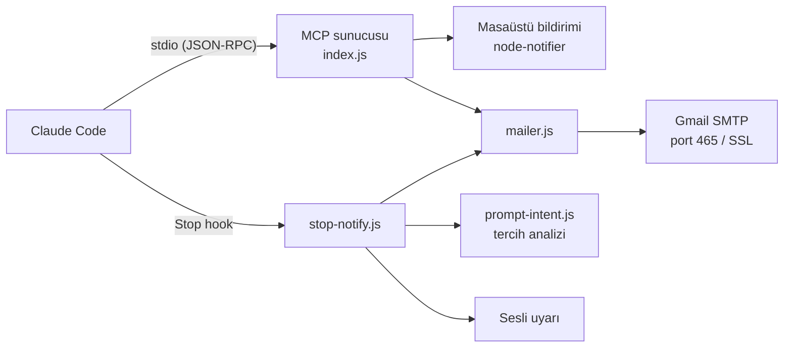

# notify-mcp

Claude Code için masaüstü ve e-posta bildirimi sağlayan, yerel olarak çalışan bir Model Context Protocol (MCP) sunucusu.


notify-mcp, Claude Code uzun süren bir görevi tamamladığında kullanıcıyı bilgilendirmek için iki kanal sunar: işletim sisteminin yerel bildirim altyapısı ve Gmail SMTP üzerinden gönderilen e-posta. Bildirimler Claude tarafından MCP araçları aracılığıyla istenerek ya da isteğe bağlı bir `Stop` hook'u ile her yanıtın sonunda otomatik olarak gönderilebilir.

## Özellikler

- **Masaüstü bildirimi:** Windows, macOS ve Linux'ta yerel, sesli sistem bildirimi.
- **E-posta bildirimi:** Yapılandırılan Gmail hesabından aynı adrese düz metin e-posta.
- **Otomatik tamamlanma bildirimi:** Claude her yanıtını bitirdiğinde sesli uyarı ve son yanıtın özetini içeren e-posta gönderen `Stop` hook'u.
- **Kullanıcı tercihlerine duyarlılık:** Hook, kullanıcının mesajlarını analiz eder. Bir kanalın istenmediği belirtilirse (ör. "e-posta gönderme") o kanalı tek tur ya da sohbet boyunca atlar.
- **Tekrarlanan bildirimlerin önlenmesi:** Claude aynı turda bildirimi MCP aracıyla zaten gönderdiyse hook ikinci kez göndermez.

## İçindekiler

- [Mimari](#mimari)
- [Gereksinimler](#gereksinimler)
- [Kurulum](#kurulum)
- [Yapılandırma](#yapılandırma)
- [Claude Code entegrasyonu](#claude-code-entegrasyonu)
- [Bildirim tercihleri](#bildirim-tercihleri)
- [MCP araç referansı](#mcp-araç-referansı)
- [Proje yapısı](#proje-yapısı)
- [Geliştirme](#geliştirme)
- [Güvenlik](#güvenlik)
- [Sorun giderme](#sorun-giderme)
- [Lisans](#lisans)

## Mimari



| Bileşen | Görev |
| --- | --- |
| `index.js` | MCP sunucusu. Claude Code ile stdio üzerinden iletişim kurar ve iki araç sunar. |
| `mailer.js` | Ortak e-posta modülü. `.env` dosyasını her gönderimde yeniden okur. |
| `stop-notify.js` | Claude Code `Stop` hook'u. Sesli uyarı ve tamamlanma e-postasını koşullu olarak gönderir. |
| `prompt-intent.js` | Kullanıcı mesajlarından bildirim tercihlerini çıkaran kural tabanlı ayrıştırıcı. |

## Gereksinimler

| Gereksinim | Açıklama |
| --- | --- |
| [Node.js](https://nodejs.org/) 22.22+ veya 24.15+ | `node-notifier` ve `nodemailer` bu sürümleri gerektirir. Node.js 24 LTS önerilir. |
| [Claude Code](https://docs.claude.com/en/docs/claude-code) | MCP sunucusunu çalıştıran istemci. |
| Gmail hesabı ve uygulama şifresi | Yalnızca e-posta bildirimi için gereklidir. |

## Kurulum

```bash
git clone https://github.com/Harley-Quinnz/notify-mcp.git
cd notify-mcp
npm install
```

## Yapılandırma

E-posta bildirimi için şablon dosyayı kopyalayın ve kendi bilgilerinizle doldurun:

```bash
# macOS / Linux / Git Bash
cp .env.example .env

# Windows (CMD / PowerShell)
copy .env.example .env
```

```dotenv
EMAIL_USER=ornek@gmail.com
EMAIL_PASS=xxxx xxxx xxxx xxxx
```

| Değişken | Açıklama |
| --- | --- |
| `EMAIL_USER` | Gmail adresi. E-postalar bu adresten aynı adrese gönderilir. |
| `EMAIL_PASS` | Gmail uygulama şifresi. Hesap şifresi kabul edilmez. Boşluklar otomatik olarak temizlenir. |

`.env` dosyası her gönderimde yeniden okunduğundan, değerler değiştirildiğinde sunucuyu yeniden başlatmak gerekmez.

### Gmail uygulama şifresi oluşturma

1. Google hesabınızda 2 Adımlı Doğrulama'yı etkinleştirin.
2. <https://myaccount.google.com/apppasswords> adresine gidin.
3. Yeni bir uygulama şifresi oluşturun ve 16 karakterlik değeri `EMAIL_PASS` olarak kaydedin.

## Claude Code entegrasyonu

### MCP sunucusu

Sunucuyu tüm projelerde kullanılabilir olacak şekilde (user scope) ekleyin. Dosya yolunu deponun bulunduğu konuma göre düzenleyin:

```bash
# Windows
claude mcp add --scope user notify -- node "C:\\Users\\<kullanici>\\notify-mcp\\index.js"

# macOS / Linux
claude mcp add --scope user notify -- node /home/<kullanici>/notify-mcp/index.js
```

Alternatif olarak yapılandırma dosyasına elle ekleyebilirsiniz:

```json
{
  "mcpServers": {
    "notify": {
      "type": "stdio",
      "command": "node",
      "args": ["C:\\Users\\<kullanici>\\notify-mcp\\index.js"]
    }
  }
}
```

Kurulumu doğrulamak için Claude Code içinde `/mcp` komutunu çalıştırın. `notify` sunucusu `connected` durumunda görünmelidir. Ardından Claude'dan doğrudan bildirim isteyebilirsiniz:

```text
Testleri çalıştır, tamamlandığında masaüstü bildirimi ve e-posta gönder.
```

### Stop hook (isteğe bağlı)

`stop-notify.js`, Claude her yanıtını tamamladığında çalışır:

- Kısa bir sesli uyarı çalar (Windows: `[Console]::Beep`, macOS: `afplay`).
- Proje klasörü, zaman, oturum kimliği ve son yanıtın özetini (en fazla 4000 karakter) içeren bir e-posta gönderir.

Hook'u etkinleştirmek için `~/.claude/settings.json` dosyasına ekleyin:

```json
{
  "hooks": {
    "Stop": [
      {
        "hooks": [
          {
            "type": "command",
            "command": "node",
            "args": ["C:\\Users\\<kullanici>\\notify-mcp\\stop-notify.js"],
            "async": true,
            "timeout": 60
          }
        ]
      }
    ]
  }
}
```

`async: true` ayarı bildirimlerin Claude'u bekletmemesini sağlar. Hatalar ve atlanan bildirimler proje klasöründeki `stop-notify.log` dosyasına kaydedilir.

## Bildirim tercihleri

Stop hook, sohbetteki kullanıcı mesajlarını analiz ederek her kanal için gönderim kararı verir. Tercihler iki kapsamda uygulanır.

### Tek tur

Mesajda bir kanalın istenmediği ya da yalnızca birinin istendiği belirtilirse karar yalnızca o tur için geçerlidir. Sonraki mesajda varsayılan davranışa dönülür.

| Örnek mesaj | Ses | E-posta |
| --- | --- | --- |
| "Testleri çalıştır" | Çalınır | Gönderilir |
| "Ses ve e-posta gönderme", "Bildirim gönderme" | Çalınmaz | Gönderilmez |
| "Ses çalma", "Sessiz çalış" | Çalınmaz | Gönderilir |
| "E-posta gönderme", "Mail atma" | Çalınır | Gönderilmez |
| "Sadece ses gönder" | Çalınır | Gönderilmez |
| "Sadece e-posta gönder" | Çalınmaz | Gönderilir |
| "Don't send an email" | Çalınır | Gönderilmez |

### Sohbet boyunca

Mesajda "bu sohbet boyunca", "ben söyleyene kadar", "aksini söyleyene kadar", "bundan sonra" veya "artık" gibi bir ifade bulunursa ya da "kapat" / "aç" fiilleri kullanılırsa tercih, değiştirilene kadar sohbetin geri kalanında geçerli olur.

| Örnek mesaj | Etki |
| --- | --- |
| "Ben söyleyene kadar bildirim gönderme", "Bildirimleri kapat" | Ses ve e-posta kapatılır. |
| "Bu sohbet boyunca sadece ses gönder" | Yalnızca ses çalınır. |
| "Artık mail atma", "Sesi kapat" | Yalnızca ilgili kanal kapatılır. |
| "Bildirimleri tekrar aç", "Sesi aç", "Artık mail atabilirsin" | Kapatılan kanal yeniden açılır. |

### Davranış ayrıntıları

- Sohbet kapsamındaki tercihler yalnızca ilgili sohbet için geçerlidir. Karar her seferinde sohbetin transcript'inden hesaplanır. Yeni bir sohbet ya da `/clear` sonrası varsayılan davranış geçerlidir.
- Sohbet boyunca kapatılmış bir kanal, bir turda açıkça istenirse ("bitince mail at") o tur için gönderilir.
- Aynı mesajda bir kanal hem istenip hem reddedilirse kanal kapalı kabul edilir.
- Türkçe karakter kullanımı ("gonderme", "eposta") ve büyük/küçük harf farkı sonucu etkilemez. İngilizce ifadeler de desteklenir.
- İsim olarak kullanılan ifadeler ("e-posta gönderme özelliğini düzelt") ve kod blokları içindeki metinler komut olarak değerlendirilmez.
- Ayrıştırıcı kural tabanlıdır. Desteklenmeyen bir ifade fark edilmezse varsayılan davranış (gönderim) uygulanır.

## MCP araç referansı

### `send_desktop_notification`

Yerel, sesli bir masaüstü bildirimi gösterir.

| Parametre | Tip | Açıklama |
| --- | --- | --- |
| `title` | `string` | Bildirim başlığı |
| `message` | `string` | Bildirim metni |

### `send_email_notification`

`EMAIL_USER` adresine, aynı adresten düz metin e-posta gönderir (Gmail SMTP, port 465, SSL).

| Parametre | Tip | Açıklama |
| --- | --- | --- |
| `subject` | `string` | E-posta konusu |
| `message` | `string` | E-posta gövdesi (düz metin) |

## Proje yapısı

```text
notify-mcp/
├── index.js           MCP sunucusu ve araç tanımları
├── mailer.js          Gmail SMTP üzerinden e-posta gönderimi
├── stop-notify.js     Claude Code Stop hook'u
├── prompt-intent.js   Bildirim tercihlerinin ayrıştırılması
├── .env.example       Ortam değişkenleri şablonu
├── package.json
├── LICENSE
└── README.md
```

## Geliştirme

### Hook kararlarını test etme

`NOTIFY_DRY_RUN=1` ortam değişkeni ile hook hiçbir bildirim göndermeden verdiği kararı JSON olarak yazdırır:

```bash
echo '{"transcript_path":"<transcript.jsonl>"}' | NOTIFY_DRY_RUN=1 node stop-notify.js
```

### stdout kullanımı

stdio transport, `stdout` akışını JSON-RPC iletişimi için kullanır. Sunucu kodunda `console.log` kullanılmamalı, tüm loglar `console.error` (stderr) ile yazılmalıdır.

## Güvenlik

- `.env` dosyası `.gitignore` ile depo dışında tutulur. Depoda yalnızca değer içermeyen `.env.example` bulunur.
- Gmail hesap şifresi yerine her zaman uygulama şifresi kullanın. Uygulama şifreleri hesap şifresini değiştirmeden tek tek iptal edilebilir.
- Uygulama şifresinin sızdığından şüpheleniyorsanız <https://myaccount.google.com/apppasswords> üzerinden iptal edip yenisini oluşturun.
- Sunucu yerel olarak çalışır ve Gmail SMTP dışında herhangi bir dış servise veri göndermez.

## Sorun giderme

| Belirti | Çözüm |
| --- | --- |
| `EMAIL_USER veya EMAIL_PASS tanımlı değil` | `.env` dosyasının proje kök dizininde bulunduğunu ve iki değişkenin de tanımlı olduğunu doğrulayın. |
| `Invalid login` / `535-5.7.8` | Hesap şifresi yerine uygulama şifresi kullanın ve 2 Adımlı Doğrulama'nın etkin olduğunu kontrol edin. |
| Masaüstü bildirimi görünmüyor | Windows'ta Ayarlar > Sistem > Bildirimler altında bildirim izinlerini ve "Rahatsız Etme" modunu kontrol edin. |
| Sunucu `/mcp` listesinde bağlanmıyor | `node index.js` komutunu elle çalıştırarak hata çıktısını inceleyin ve `args` içindeki yolun mutlak olduğundan emin olun. |
| Hook bildirimi gelmiyor | `stop-notify.log` dosyasını inceleyin. Bildirim kullanıcı tercihi nedeniyle atlanmış olabilir. |
| İstenmediği belirtildiği halde bildirim gönderiliyor | `settings.json` içinde koşulsuz çalışan eski bir Stop hook'u bulunmadığını doğrulayın. Değişiklikten sonra `/hooks` menüsünü açın ya da Claude Code'u yeniden başlatın. |

## Lisans

Bu proje MIT lisansı ile lisanslanmıştır. Ayrıntılar için [LICENSE](LICENSE) dosyasına bakın.
